# CodeBase Analysis — Codebase Intelligence Platform

[](https://github.com/shreyasvishwa1/codebase-analysis/actions/workflows/tests.yml)
[](https://github.com/shreyasvishwa1/codebase-analysis/actions/workflows/security-audit.yml)

**An intelligent codebase analysis platform that helps developers understand software
repositories through static analysis, repository intelligence and AI-assisted code
understanding.**

Self-hosted · FastAPI + React/TypeScript · repository code is never executed.

**Live demo:** https://codebase-analysis.onrender.com (free hosting: the first visit after a
quiet spell can take about a minute to wake the server). The **Import the sample** button on the
Upload page loads a small repository with planted problems, so there is something to analyze
straight away.

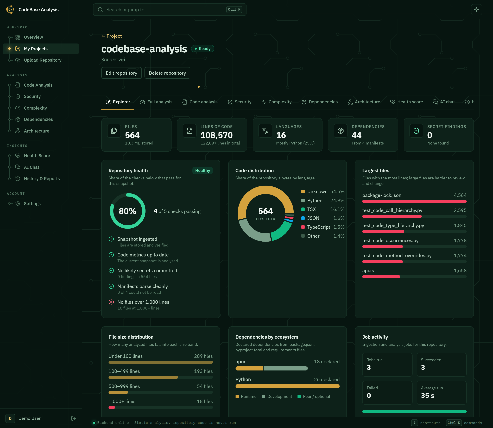

## Overview

Import a repository as a ZIP upload or a public GitHub archive. One **full analysis** then
checks it in the background and keeps every run in its history:
- **code quality**: bug risks, unused and dead code, duplication, naming, documentation;
- **security**: committed secrets, injection and XSS risks, insecure settings and containers,
  mapped to the OWASP Top 10;
- **complexity and maintainability** of every function and file;
- **dependencies**: outdated packages and known vulnerabilities (OSV.dev);
- **architecture**: components, the imports between them, routes, data stores and
  infrastructure, drawn as a diagram;
- a **health score** from 0 to 100 that shows how it was calculated and how to raise it.

Each analysis can be saved as a **PDF report**. You can also browse and search the code,
navigate Python across files, and run five static diagnostics. Two optional AI features need an
Anthropic or Google Gemini key: an **AI chat** that answers questions about the repository with
citations to the exact lines, and a one-file explanation.

Analyzed code is never executed, imported or installed. Python is parsed with the
standard-library `ast` and `tokenize` modules, and the external analyzers (Ruff, Bandit,
Lizard, Radon) read a private copy of the files.

How accurate is the security analysis? On a labelled benchmark it was compared with Semgrep:
precision 0.868, recall 0.708 and F1 0.780, against Semgrep's 0.932, 0.631 and 0.752. The
method and the limitations are in [docs/EVALUATION.md](docs/EVALUATION.md).

## Problem Statement

Getting to know an unfamiliar codebase is slow. Editor tooling usually needs a local checkout
and a working environment, and some tools run project code (imports, build scripts) to answer
questions. That is a risk when the repository is not trusted. Developers need navigation and
defect signals they can rely on for code they do not trust, with stated limits instead of
guesses.

## Solution

- **Isolated ingestion**: a background worker validates every archive entry before writing
  anything. It then stores a snapshot in which every file has a recorded SHA-256.
- **Static, deterministic analysis**: Python's own parser and tokenizer, with explicit rules.
  Cases the syntax cannot decide are counted separately, never guessed.
- **On demand and protected**: every request is authenticated and ownership-checked, search
  and analyses are rate-limited, and every result links to the exact line.

## Key Features

| Area | Capabilities |
| --- | --- |
| Ingestion | ZIP upload or public GitHub archive, from one Upload Repository page, or one click to import the sample repository; background jobs with status; pending jobs can be cancelled. File contents are also kept in the database, so a host that wipes its disk (such as Render's free plan) never needs the ZIP uploaded again |
| Full analysis | One background run analyzes a repository snapshot (dependency folders such as `node_modules/` and build output excluded) and stores the results; every run is kept in the repository's history |
| Overview | Totals across all your repositories from their latest stored runs: projects, repositories, lines of code, analyses, active jobs, language distribution, recent analyses and each repository's latest health score (lowest first) |
| Architecture | Each full analysis also maps the architecture: components (directories) and the imports between them in an interactive diagram, dependency cycles, technologies and data stores, API routes, entry points, Dockerfiles, Docker Compose services, CI and deployment files, and observations such as a layered structure or circular dependencies. Every item links to the file and line it comes from |
| Usability survey | **Rate this app**: the ten statements of the System Usability Scale (Brooke, 1996), answered from 1 to 5. Each account answers once and can change its answers. The results show the number of responses, the mean SUS score (0-100) with its grade on Sauro and Lewis's curved scale (68 is average), the spread, each statement's average answer, and a CSV of the anonymous answers (respondent number, answers, score, day; no names or emails) for analysis |
| Settings | Profile (display name), what the account holds, password change (other sessions are signed out), the health-score weights, whether the AI features are configured, and account deletion after the password and a confirmation |
| History & Reports | Every full analysis of your repositories, newest first, with its health score and the change from the previous analysis, critical and high security findings, quality issues, complex functions and vulnerable packages. Create a PDF report of any analysis (overview, health score with calculations, security findings with fixes, code quality, complexity, dependencies, architecture); reports are kept so you can download them again |
| AI Chat | Ask questions about a repository in plain language. Answers are built from the passages of code that match the question (PostgreSQL full-text search over Python definitions and line windows) and from the results of its latest full analysis, and they cite the files and lines they rely on as links into the explorer. Conversations are kept per repository. Secrets are masked before anything is stored or sent, and repository content is passed to the model as untrusted data. Needs `ANTHROPIC_API_KEY` or `GEMINI_API_KEY` |
| Health Score | One score from 0 to 100 (grade A-F) per analysis: a weighted average of security, code quality, complexity, maintainability, dependency health and architecture. Each dimension shows its inputs, the calculation with the actual numbers and what would raise it. The weights are yours to change, and a trend shows the score across runs. Formulas: [docs/ARCHITECTURE.md](docs/ARCHITECTURE.md#6-code-health-score-phase-7) |
| Dependencies | Each full analysis also checks dependency health: every package declared in `package.json`, `pyproject.toml` and `requirements*.txt` (runtime and development), the version it allows, the latest release on PyPI or npm (major, minor or patch behind), known vulnerabilities from OSV.dev with CVE ids, CVSS scores and the fixed version, and packages declared with conflicting versions. Vulnerable versions also appear on the Security page (OWASP A06). Package names and versions are sent to PyPI, npm and OSV.dev; `DEPENDENCY_LOOKUPS=false` turns that off |
| Complexity | Each full analysis also measures complexity: the cyclomatic complexity of every function (Lizard, about twenty languages) rated Low, Medium or High, the maintainability index of every file (Radon for Python; the same formula estimated for other languages), functions, classes, lines of code and duplication. The most complex functions open in the explorer at their line; files can be sorted by complexity, maintainability or size |
| Security | Each full analysis also checks security: committed secrets and `.env` files, injection risks (SQL and shell commands built from strings, `eval`), XSS sinks, disabled TLS verification, insecure JWT and CORS settings, debug settings and Dockerfiles that run as root, plus Bandit for Python. Findings are rated Critical, High, Medium or Low, marked confirmed or potential, and mapped to the OWASP Top 10 with a CWE; each explains the risk and the fix. Secret values are never shown, and the page never calls a project secure |
| Code analysis | Each full analysis also finds code-quality issues: bug risks, syntax errors, unused and unreachable code, duplicate blocks (every language), naming, missing docstrings, formatting, TODO/FIXME markers and very long files. Python is checked with Ruff on a private copy, so repository code is never run. Each issue shows its file, line, category, severity, why it matters and a suggested fix, and links to the line in the explorer. Issues can be filtered by severity, category, file and text |
| Dashboard | Per-repository overview: files, lines of code, languages, dependencies and secret findings; a health score from five checks; code distribution, largest files, file sizes, dependencies by ecosystem and job activity |
| Browsing and search | File tree with a path filter, language statistics, plain-text file viewer, literal code search, exact Python symbol search |
| Code intelligence | Outline, imports, importers, go to definition, find references, name occurrences, call hierarchy, type hierarchy, method overrides |
| Static diagnostics | Unused imports, unbound names, unused variables, redefined names, unreachable code |
| Repository analysis | Code metrics, dependency inventory, secret scan |
| AI (optional) | Explain one file with Anthropic or Google Gemini |
| Management | Projects and repositories: create, rename, delete (deleting requires typing the name) |
| Accounts | Register, sign in, and reset a forgotten password through an emailed link (optional, needs SMTP) |

## Architecture

The full design of the repository intelligence system (modules, database, analysis pipeline,
health score, AI chat and the development phases) is in [docs/ARCHITECTURE.md](docs/ARCHITECTURE.md).


```
Browser: React SPA (Vite dev server, http://127.0.0.1:5173)
   │  /api/v1 (JSON, bearer token), proxied by Vite in development
   ▼
FastAPI on uvicorn (http://127.0.0.1:8000)
   │  authentication → ownership → rate limit (search, analyses) → service
   ├──► PostgreSQL 16: users, projects, repositories, files (with SHA-256) and their
   │                   compressed contents, jobs, analysis runs and results, reports, chats
   ├──► Redis 7: arq job queue and rate-limit counters
   │      └──► arq worker: ingestion, full analysis, code metrics, maintenance (every 5 minutes)
   ├──► DATA_DIR/repositories/<repository_id>/: extracted files, read only through
   │                                            the verified reader (rebuilt from the
   │                                            database if the disk was wiped)
   └──► Anthropic or Gemini API (optional): the AI chat and file explanations
```

In production one container runs everything behind Caddy, which serves the built frontend,
passes `/api` to the backend and adds the security headers: see [Deployment](#deployment).

**An analysis request**
1. The frontend sends the bearer token with every request to its own `/api/v1`.
2. FastAPI validates the token.
3. The route checks that the project or repository belongs to the user.
4. The route applies the per-user rate limit for search and analyses.
5. The service loads the file snapshot with a single query, then reads files through the
   verified reader and analyzes them in a worker thread.

**An ingestion**
1. The API records a pending job and queues its id (JSON, never pickle).
2. The worker obtains the archive and validates every entry.
3. It extracts into a staging directory.
4. It replaces the file rows and marks the repository ready in one transaction, then swaps
   the staging directory into place.
5. Any failure rolls back and keeps the previous snapshot. A maintenance job recovers stuck
   jobs and removes leftovers.

## Technology Stack

| Layer | Technologies |
| --- | --- |
| Backend | Python 3.12, FastAPI, SQLAlchemy (async, asyncpg), Alembic, PostgreSQL 16, Redis 7, arq, Pydantic, PyJWT, argon2-cffi, ReportLab (PDF reports) |
| Frontend | React 18, TypeScript, Vite, Tailwind CSS, TanStack Query, React Router, Axios, Recharts |
| Analysis | Python standard library: `ast`, `tokenize` (plus `json` and `tomllib` for manifests); Ruff (code quality), Bandit (Python security), Lizard and Radon (complexity and maintainability); PyPI, npm and OSV.dev for dependency versions and vulnerabilities |
| Testing | pytest, ruff, mypy, Vitest, Testing Library; GitHub Actions runs everything on each push |
| Deployment | Docker (non-root containers), Caddy, Render (free plan) with a Neon PostgreSQL database |
| Local infrastructure | Docker Compose for PostgreSQL and Redis (development only) |

## Security

- **Accounts:** Argon2 password hashes, password rules following NIST SP 800-63B, signed tokens bound to the password, rate-limited sign-in and password reset.
- **Repositories:** every archive entry is validated before extraction, every read is checked against the SHA-256 recorded at ingestion, and repository code is never run, imported or installed.
- **Isolation:** every request is ownership-checked; another user's project answers exactly like a missing one.
- **Server:** strict security headers (CSP, HSTS), capped request sizes, non-root containers, API docs off in production.
- **Supply chain:** pinned dependencies, Dependabot, and a weekly vulnerability audit of every package.

The details are in [docs/SECURITY.md](docs/SECURITY.md).

## Testing & Quality Engineering

Results at the latest commit (23 November 2026):

| Check | Result |
| --- | --- |
| Frontend tests (Vitest, Testing Library, jsdom) | 1,486 passing in 57 files |
| Backend tests (pytest) | 3,217 passing in 56 files on Linux; 34 skipped there are Windows-only tests (directory junctions) |
| TypeScript typecheck and production build | Passing |
| `ruff check` and mypy | Passing |
| Continuous integration | GitHub Actions runs every check above on each push and pull request, on Linux with real PostgreSQL and Redis ([tests.yml](.github/workflows/tests.yml)) |
| Security accuracy against Semgrep | On a labelled corpus of 65 vulnerable and 47 safe cases: precision 0.868, recall 0.708, F1 0.780 (Semgrep 1.184: 0.932, 0.631, 0.752); method and limitations in [docs/EVALUATION.md](docs/EVALUATION.md) |
| Mutation testing | 287/287 mutants caught in the final development phase; 17/17 for the code-quality engine; 23/23 for security analysis; 21/21 for complexity analysis; 30/30 for dependency analysis; 30/30 for architecture analysis; 43/43 for the health score; 52/52 for the AI chat; 47/47 for PDF reports and history; 28/28 for settings and the account; 14/14 for the chat fixes (retries and fallback, name matching, answer formatting) |

- **Isolation**: frontend tests mock the API at the axios adapter, so no backend is needed.
  Backend database and API tests run against a throwaway, already-migrated PostgreSQL database
  inside rolled-back transactions, and a disposable Redis.
- **Oracles**: diagnostics are cross-checked against CPython's own `symtable` and compiler
  output, run on code the tests write themselves. Seeded random programs drive differential
  tests.
- **Security tests**: every Python analysis has a test that patches `compile`, `exec`, `eval`,
  `subprocess` and sockets to prove repository code never runs. Endpoints are also tested for
  ownership checks, for ownership before rate limiting, and for the 409 answer when the
  snapshot changes.
- **Mutation testing**: each change in the final development phase (redefined names, the
  file-tree filter, unreachable code) was mutation-tested.
  - Every mutant was applied, tested, and the file restored and checked against its SHA-256.
  - Each survivor was either shown to be equivalent and replaced, or answered with a new test.
  - The runners were scratch tooling and are not part of this repository.
  - The 287 figure covers the final phase only, not mutation coverage of the whole application.

## Screenshots

Taken from a local run in the default dark theme. "codebase-analysis" is this repository
analyzing itself; "shop-api (sample)" is the built-in sample, whose keys and passwords are all
fake.

**Landing page**

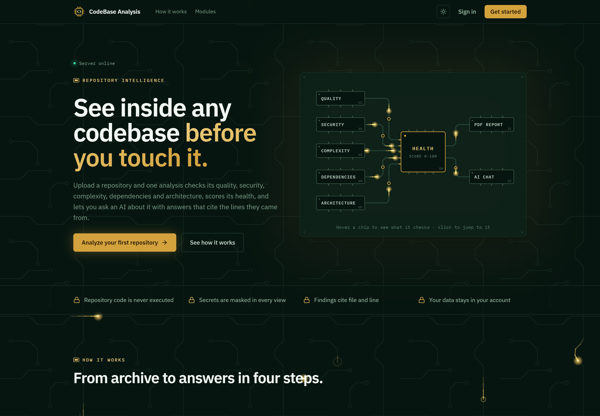

**Sign in**, with a link to reset a forgotten password by email

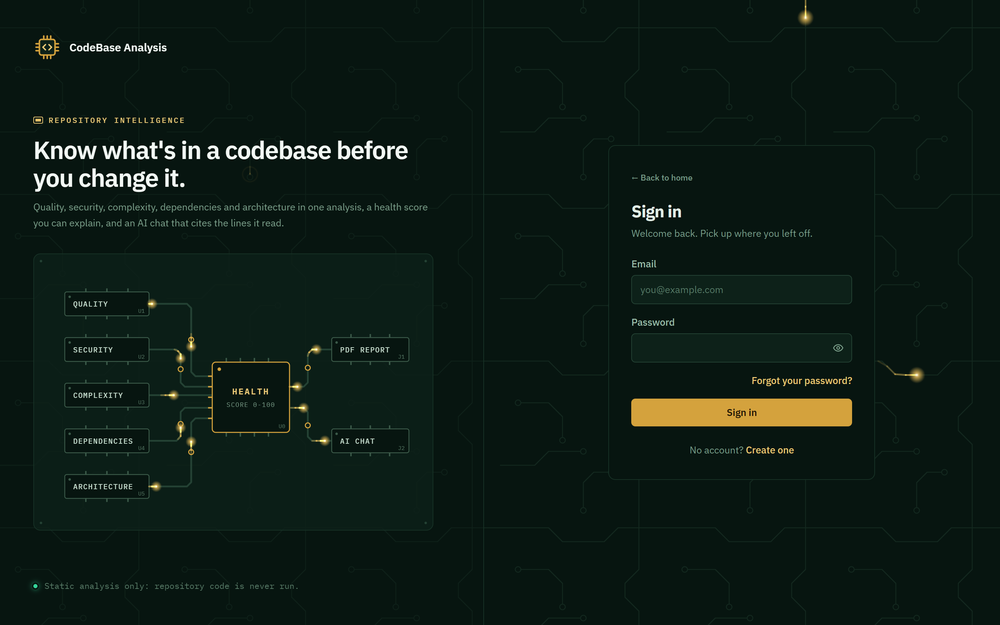

**Overview**: totals across every repository, languages, recent analyses and each repository's
health score

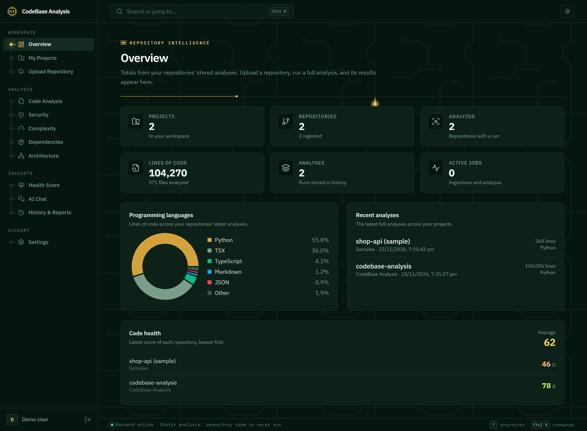

**Upload repository**: a ZIP or a public GitHub repository, or the one-click sample

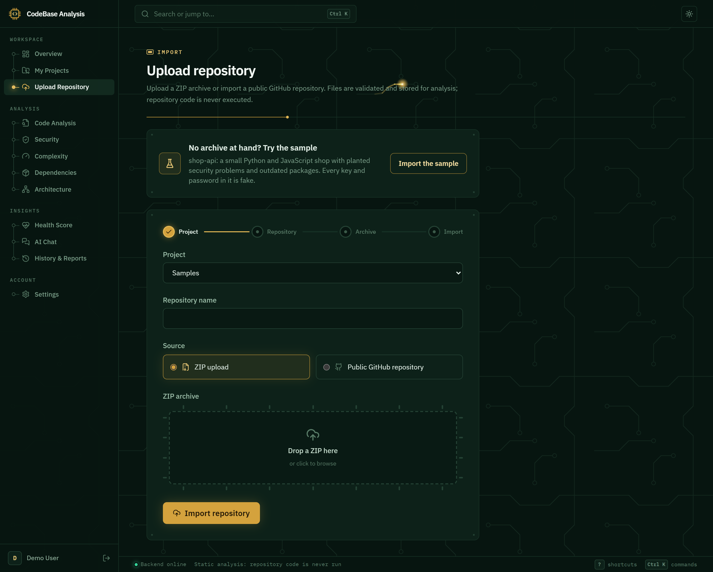

**Repository dashboard**: headline numbers, health checks, code distribution, largest files,
file sizes, dependencies and job activity


**Code intelligence on one file**: outline, imports resolved to repository files, and the
unused-imports diagnostic

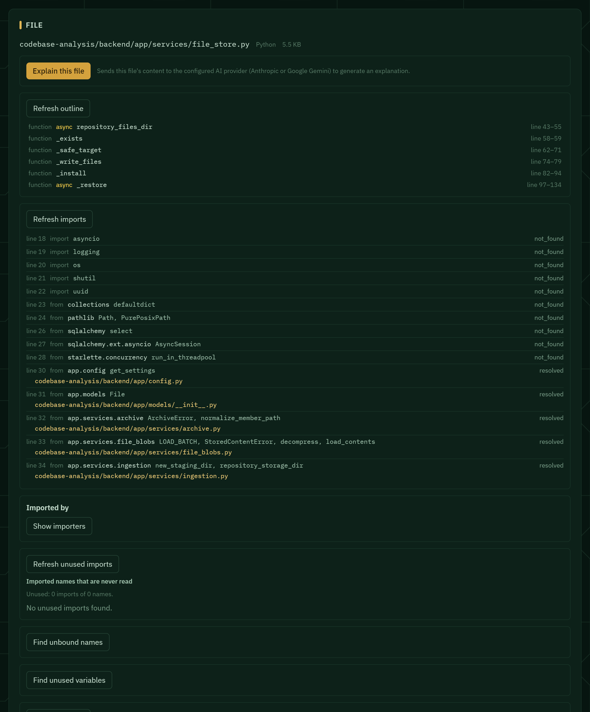

**Health score**: six dimensions, each with its calculation and how to raise it

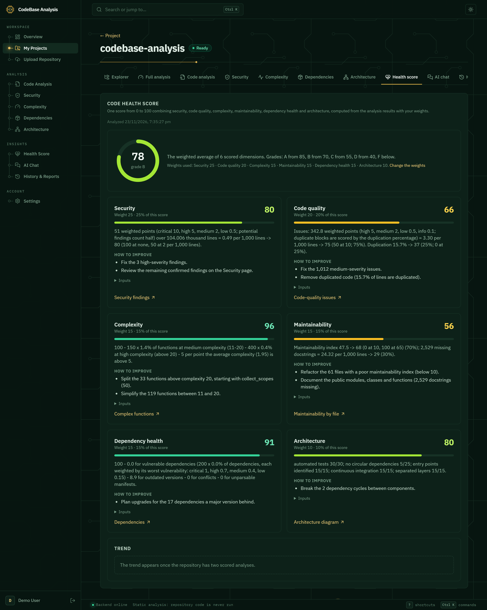

**Security**: findings by severity and confidence, mapped to the OWASP Top 10 (the sample)

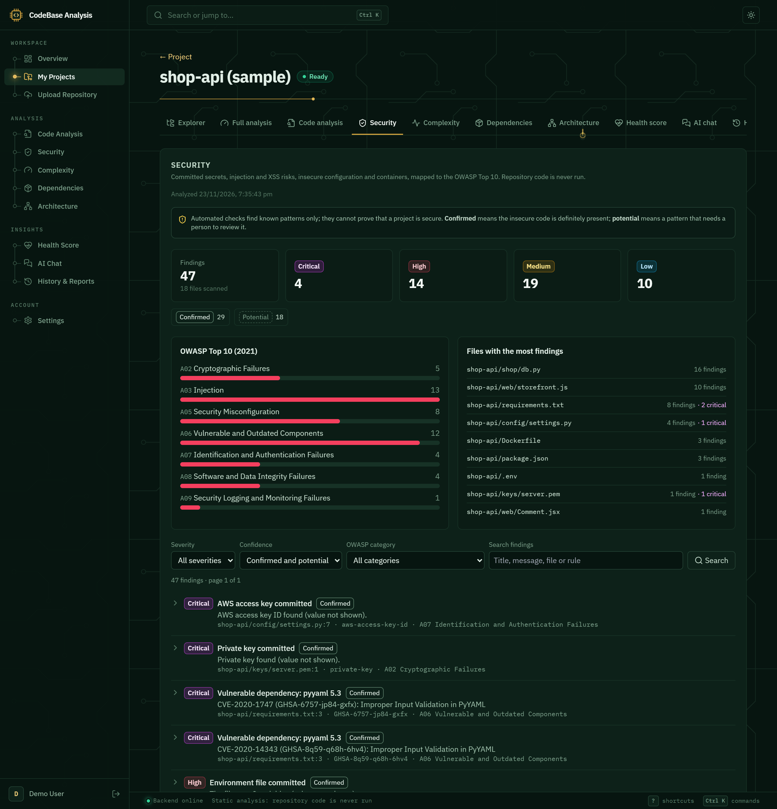

**Code quality**: issues by category and severity, with the files that have the most

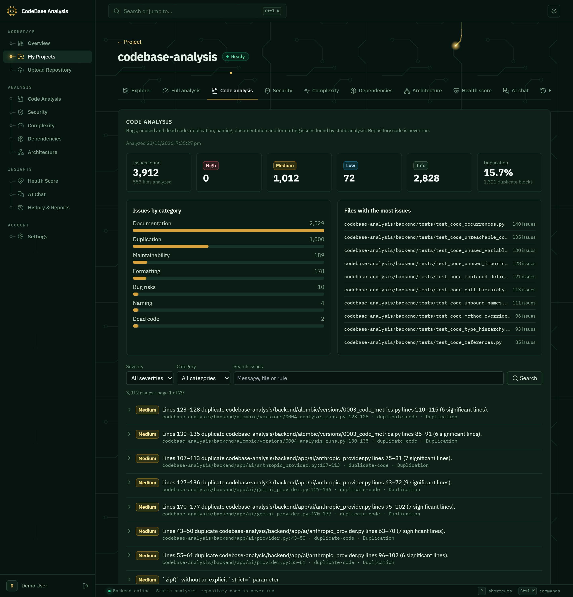

**Complexity**: cyclomatic complexity of every function and maintainability of every file

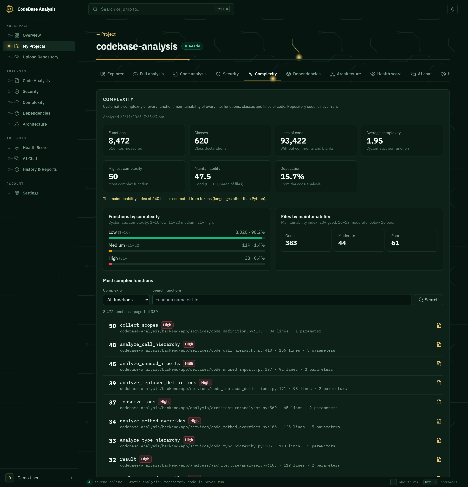

**Dependencies**: outdated packages and known vulnerabilities from OSV.dev (the sample)

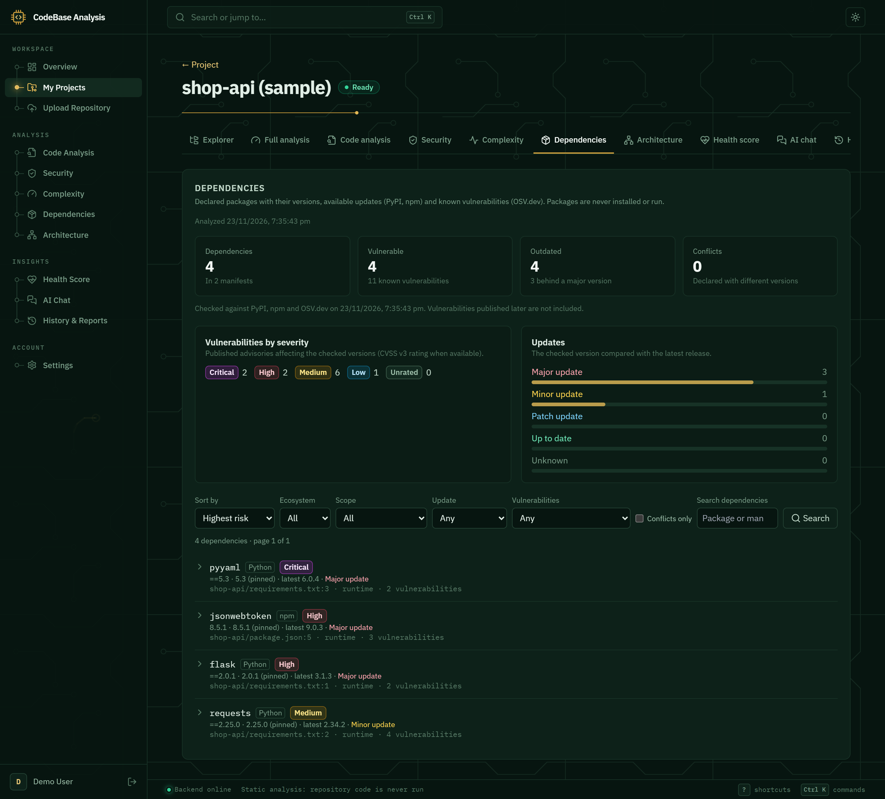

**Architecture**: components in layers, the imports between them, and observations that link to
their evidence

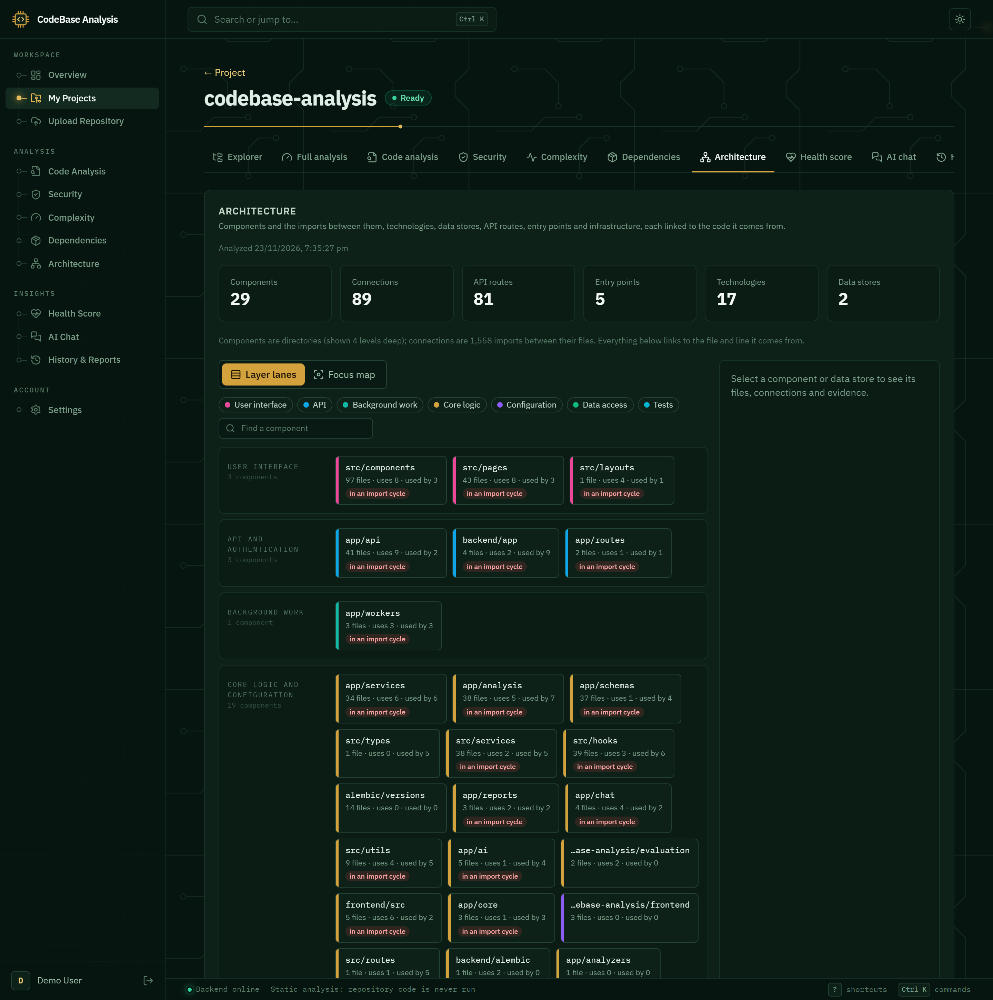

**History and reports**: every analysis with its headline numbers, and the PDF reports created
from them

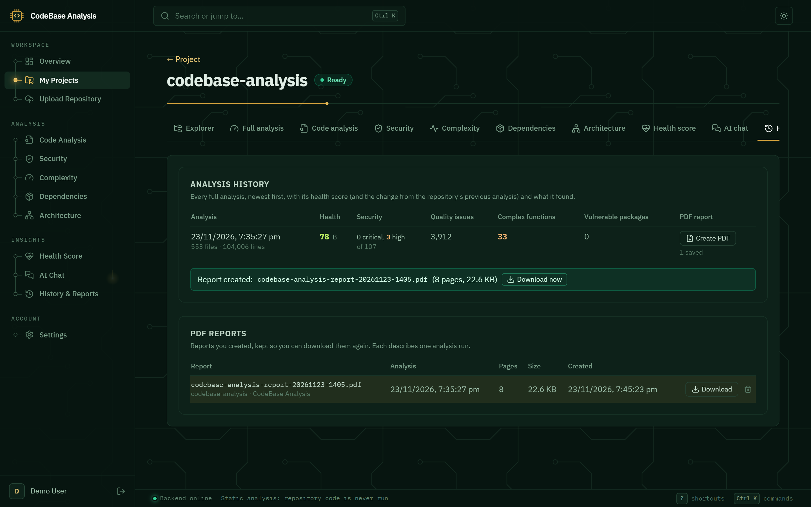

## Demo

Try it at https://codebase-analysis.onrender.com. The intended workflow takes about five
minutes:

**Sign up → Import → Full analysis → Health score → Findings → Report**

1. Create an account. On **Upload Repository**, click **Import the sample**, or upload your
   own ZIP or a public GitHub URL.
2. Open the repository and run a **full analysis**. Every stage shows its progress.
3. Open the **Health score** to see the six dimensions, how each was calculated and what would
   raise it.
4. Follow the links to the **Security**, **Code analysis**, **Complexity**, **Dependencies**
   and **Architecture** pages. Every finding links to its file and line in the explorer.
5. In the explorer, open a Python file to see its outline and imports, go to a definition, and
   run the diagnostics.
6. Create a **PDF report** from **History & Reports**. If an AI key is configured, ask the
   **AI chat** about the code.

<!-- Demo video: add the link to the recorded walkthrough here -->

## Installation

**Requirements**: Python 3.12, Node.js 22 (LTS), and Docker (or local PostgreSQL 16 and
Redis 7).

From the repository root:

1. Copy `.env.example` to `backend/.env`, which the backend reads. Copy it again to a
   repository-root `.env`, which Docker Compose reads for the `POSTGRES_*` values.
2. Choose your own local database password and `SECRET_KEY`. Never commit either file.
3. Start PostgreSQL and Redis (development only):
   ```bash
   docker compose up -d postgres redis
   ```

## Environment Variables

Two are required: `SECRET_KEY` (at least 32 characters) and `DATABASE_URL` (a `postgresql+asyncpg://` URL). Everything else is optional: Redis, upload limits, the AI provider keys (`ANTHROPIC_API_KEY` or `GEMINI_API_KEY`), password-reset email and rate limits. The full list, with defaults, is in [docs/CONFIGURATION.md](docs/CONFIGURATION.md).

## Running the Backend

From `backend/`:
```bash
python -m venv .venv
.venv/Scripts/pip install -r requirements-dev.txt -c constraints.txt
.venv/Scripts/alembic upgrade head
.venv/Scripts/uvicorn app.main:app --reload --host 127.0.0.1 --port 8000
```

In a second terminal, start the worker, which ingestion and code metrics need:
```bash
.venv/Scripts/arq app.workers.worker.WorkerSettings
```

On macOS or Linux, use `.venv/bin/` instead of `.venv/Scripts/`. `constraints.txt` pins every
backend package to the verified versions. In development, the interactive API documentation
is at http://127.0.0.1:8000/docs.

## Running the Frontend

From `frontend/`:
```bash
npm install
npm run dev
```

Open http://127.0.0.1:5173. The dev server proxies `/api` to the backend.

## Testing

**Frontend** (from `frontend/`):
```bash
npm test
npm run typecheck
npm run build
```

**Backend** (from `backend/`):
```bash
.venv/Scripts/python -m pytest
.venv/Scripts/ruff check .
.venv/Scripts/mypy
```

The same checks run on GitHub Actions for every push and pull request
([.github/workflows/tests.yml](.github/workflows/tests.yml)).

Analysis tests run offline. Database and API tests are skipped unless these variables are
set:
- `TEST_DATABASE_URL`: an already-migrated PostgreSQL database whose name ends in `_test`.
  Every test runs inside a transaction that is rolled back.
- `TEST_MIGRATION_DATABASE_URL`: a separate, disposable database for migration tests.
- `TEST_REDIS_URL`: a loopback Redis with a database index other than 0. The rate-limit tests
  flush it.

## API Overview

All endpoints are under `/api/v1` and need a bearer token, except sign-up, sign-in, password reset and the health checks. The full list of endpoints is in [docs/API.md](docs/API.md).

## Documentation

| Document | What it covers |
| --- | --- |
| [docs/ARCHITECTURE.md](docs/ARCHITECTURE.md) | Modules, database, analysis pipeline, health score formulas, AI chat |
| [docs/FEATURES.md](docs/FEATURES.md) | Each code-intelligence feature, diagnostic and repository analysis, and its limits |
| [docs/EVALUATION.md](docs/EVALUATION.md) | Accuracy of the security analysis against Semgrep |
| [docs/SECURITY.md](docs/SECURITY.md) | Accounts, sessions, archive safety, rate limits, production settings |
| [docs/API.md](docs/API.md) | Every REST endpoint |
| [docs/CONFIGURATION.md](docs/CONFIGURATION.md) | Every environment variable |
| [DEPLOY-RENDER.md](DEPLOY-RENDER.md) | Hosting on Render and Neon (free), step by step |

## Limitations

- **Language**: code intelligence and diagnostics cover Python only, with Python 3.12 syntax.
- **No type inference**: attribute uses such as `self.method()` are reported as unsupported.
  Find references does not support methods or nested classes.
- **Diagnostics are file-level**: each looks at one file, and files above 256 KiB are not
  parsed.
- **GitHub import**: public repositories only.
- **Repositories**: the source cannot be changed after creation. Re-ingest to refresh the
  files, or create a new repository.
- **Sessions**: there are no refresh tokens. A session ends when the tab closes or the token
  expires. Resetting a password does not end sessions that are already signed in.
- **Navigation**: files and lines are not reflected in the URL, so they cannot be shared as
  links.
- **Security analysis** matches known patterns, through Bandit and the app's own rules, without
  following data through the program. It does not find path traversal, server-side request
  forgery or open redirects. It is a review aid, never proof that a project is secure; see
  [docs/EVALUATION.md](docs/EVALUATION.md).
- **Deployment**: single-server only (see [Deployment](#deployment)). On Render's free plan the
  service sleeps after 15 idle minutes; a GitHub Actions job pings it every 10 minutes to keep
  it awake.

## Deployment

The live demo runs on **Render's free plan** with a **Neon** PostgreSQL database. It is
built from [render.yaml](render.yaml) and [deploy/render/Dockerfile](deploy/render/Dockerfile):
one container holding Caddy, the API, the worker and a private Redis.
- Render wipes its disk when the service restarts, sleeps or redeploys. Uploaded files are also
  kept in the database and restored automatically, so a ZIP never has to be uploaded again.
- Every push to `main` redeploys it, and the database migrations run on start.

Other ways to host it:
- [DEPLOY-RENDER.md](DEPLOY-RENDER.md): the Render and Neon setup, step by step (free, no card).
- [DEPLOY.md](DEPLOY.md): Railway, using the root [Dockerfile](Dockerfile).
- [DEPLOY-ORACLE.md](DEPLOY-ORACLE.md): an Oracle Cloud Always Free server.

The root `docker-compose.yml` is for local development only.

## Future Scope

Planned future work, not yet implemented:
- Data-flow (taint) analysis from request inputs: path traversal, SSRF and open redirects.
- Optionally running Semgrep inside an analysis, as Bandit runs today. The evaluation shows the
  two tools complement each other.
- Shareable links to a file and line.
- A repository-wide diagnostics dashboard.
- A file-level import graph (the architecture diagram shows imports between directories).
- Type-informed references, such as method references.
- Refresh tokens.

## License

Released under the [MIT License](LICENSE).
